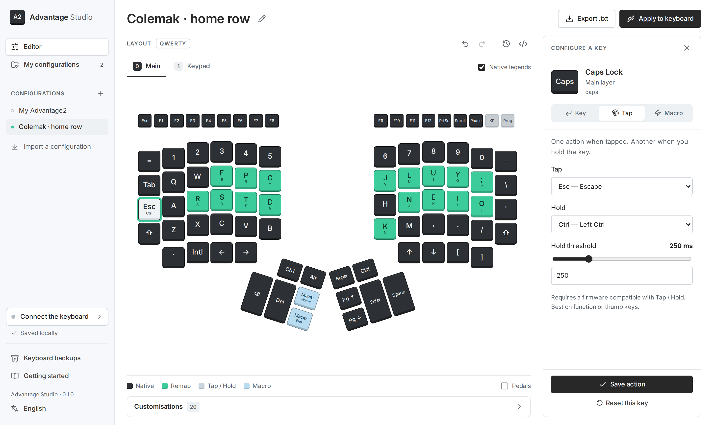
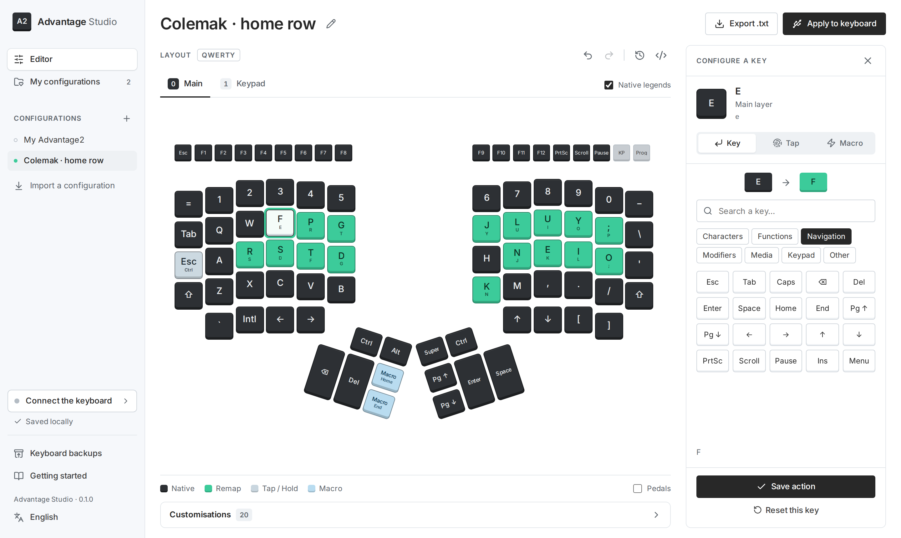
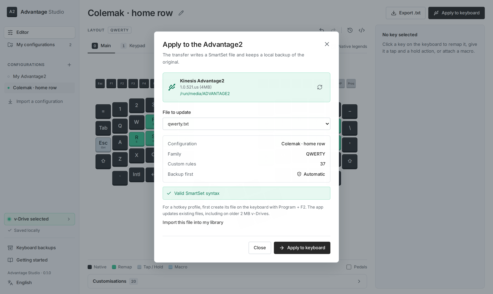
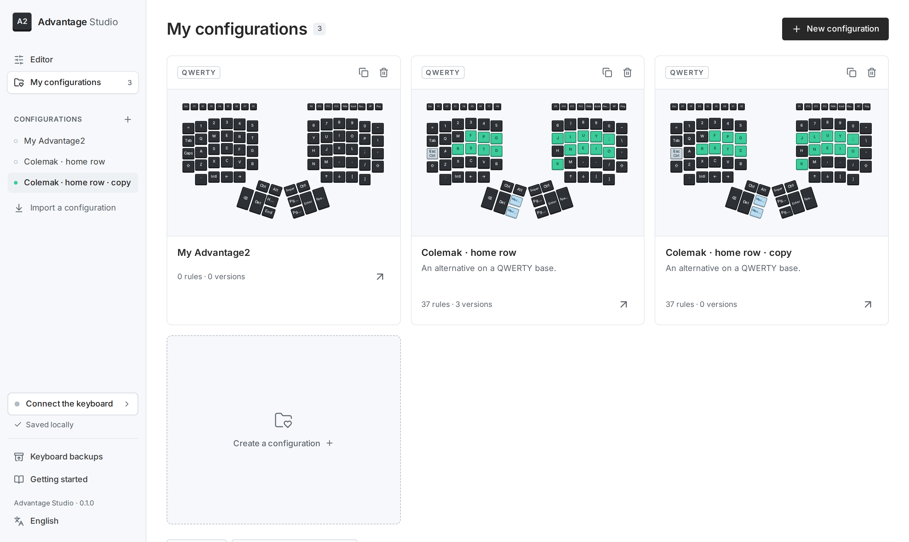

<h1 align="center">Advantage Studio</h1>

<p align="center">
  A visual configurator for the <strong>Kinesis Advantage2</strong> with its original SmartSet firmware.<br />
  Remap keys, build tap/hold keys and macros, then write the layout to the keyboard — safely.
</p>

<p align="center">
  <a href="https://elo-i.github.io/advantage-studio/"><strong>Open the web app</strong></a>
  ·
  <a href="https://github.com/ELO-I/advantage-studio/releases/latest"><strong>Download the desktop app</strong></a>
</p>

<p align="center">
  React · TypeScript · Tauri 2 · Local only, no account, no server · English and French
</p>



## Features

- **Visual editor** for both firmware layers (**Main** and **Keypad**), with the optional pedals. Every key shows its action, and its colour shows its kind: remap, tap / hold or macro.
- **Three kinds of action** per key: a simple remap, a tap / hold key with its own threshold, or a macro with up to two modifier co-triggers. A text-to-macro helper converts a phrase into SmartSet tokens.
- **A library of configurations**: create from QWERTY, Dvorak or Colemak presets, rename, duplicate, import, export. Every change is saved automatically, with undo/redo and the last 50 versions of each configuration.
- **The SmartSet file, always visible**: open the raw file, fix it with live diagnostics. Lines the editor does not understand are kept, never dropped.
- **Safe transfer to the keyboard** (desktop app): v-Drive detection, backup of the original, fingerprint check, in-place write that suits older 2 MB v-Drives, then read-back verification.
- **Portable**: export a SmartSet `.txt` for the keyboard, or your whole library as `.json` with its history.

<table>
  <tr>
    <td width="50%"></td>
    <td width="50%"></td>
  </tr>
  <tr>
    <td align="center"><sub>Pick an action by category or by search</sub></td>
    <td align="center"><sub>Apply to the keyboard, with an automatic backup</sub></td>
  </tr>
  <tr>
    <td colspan="2"></td>
  </tr>
  <tr>
    <td colspan="2" align="center"><sub>Keep several configurations and switch between them</sub></td>
  </tr>
</table>

## Web app or desktop app

|                                                   | [Web app](https://elo-i.github.io/advantage-studio/) | [Desktop app](https://github.com/ELO-I/advantage-studio/releases/latest) |
| ------------------------------------------------- | :--------------------------------------------------: | :----------------------------------------------------------------------: |
| Build a configuration: remaps, tap / hold, macros |                          ✓                           |                                    ✓                                     |
| Library, history, undo / redo, English / French   |                          ✓                           |                                    ✓                                     |
| Import and export `.txt` and `.json` files        |                          ✓                           |                                    ✓                                     |
| Install on the keyboard automatically             |                                                      |                                    ✓                                     |
| Backup of the replaced file and write check       |                                                      |                                    ✓                                     |

**The web app** needs nothing to install: build your configuration in the browser, then export the `.txt` file and copy it to the v-Drive yourself. Your data stays in your browser; nothing is sent to a server.

**The desktop app** (Linux, Windows, macOS) also installs the configuration on the keyboard for you, with a backup of the original and a check after writing. The installers are not code-signed yet: Windows and macOS warn on first launch.

The two keep separate libraries; export and import the `.json` library to move from one to the other.

## Run from source

Prerequisites: Node.js 24, stable Rust ≥ 1.94 and the [Tauri system dependencies](https://v2.tauri.app/start/prerequisites/).

```sh
npm ci
npm run desktop   # desktop app
npm run dev       # web app, at http://127.0.0.1:1420
```

## Apply a configuration to the keyboard

With the desktop app:

1. Enable Power User mode if needed: **Program + Shift + Escape**.
2. Open the v-Drive: **Program + F1**, and wait for the drive to appear.
3. Click **Apply to keyboard**, select the detected keyboard and the existing file to update.
4. The app backs up the original locally, checks its fingerprint, writes the file in place and checks the content read back.
5. Reload the layout on the keyboard: **Program + F3** for `qwerty.txt`, **Program + F4** for `dvorak.txt`, or **Program + the hotkey** for a hotkey profile. Eject the drive from your OS, then close the v-Drive with **Program + F1**.

This is a configuration transfer, not a firmware update. The app cannot press the physical shortcuts for you. It updates existing files, as the older 2 MB v-Drive requires: create a hotkey profile on the keyboard with **Program + F2** before editing it here. The Advantage360 and QMK-modified controllers are not supported.

Backups are listed from the sidebar. Restoring one adds it to your library, where you can check it before applying it. The library and backups live in the app's standard data folder (`studio.advantage.configurator`), depending on the OS.

## Languages

The interface is in English by default, and also available in French: pick the language at the bottom of the sidebar. Adding a language means adding one catalog file in [`src/i18n`](src/i18n); see [docs/architecture.md](docs/architecture.md#languages).

## Development

```sh
npm run check            # lint, unit tests, type check and web build
npx playwright install chromium
npm run test:e2e         # browser journeys
npm run test:rust        # backend tests
npm run build:desktop    # desktop executable and installers
npm run screenshots      # README images, with `npm run dev` running
```

The build writes the executable to `src-tauri/target/release` and the installers to `src-tauri/target/release/bundle`; `npm run build:desktop -- --no-bundle` builds the executable only.

Publishing is automatic:

- **Web app**: every push to `main` that passes the checks is deployed to GitHub Pages (`.github/workflows/pages.yml`).
- **Checks**: every push to `main` and every pull request runs the web checks, the browser journeys and the Rust tests on Linux (`.github/workflows/verify.yml`).
- **Desktop app**: pushing a version tag such as `v1.0.0` builds the installers for Linux (`.deb`, `.rpm`, `.AppImage`), Windows and macOS (Intel and Apple Silicon) and publishes them as a GitHub release (`.github/workflows/release.yml`). Run that workflow by hand to try the builds before tagging. Code signing and macOS notarisation are not configured.

Rust commands go through `scripts/run-native.js`, which uses the system environment. If the Linux build dependencies were extracted into `work/native` instead of being installed (no `sudo`), it adds their paths and reuses the Cargo cache of `work/cargo-home`. The `work/` folder is ignored by Git. Offline: `npm run test:rust -- --offline`.

## Documentation

- [Architecture and validation](docs/architecture.md): code organisation, SmartSet format, transfer safety, local data, tests and reference sources.
- [Design system](docs/design.md): colours, typography and layout rules.

## License

[MIT](LICENSE). Advantage Studio is an independent project, not affiliated with Kinesis Corporation.
